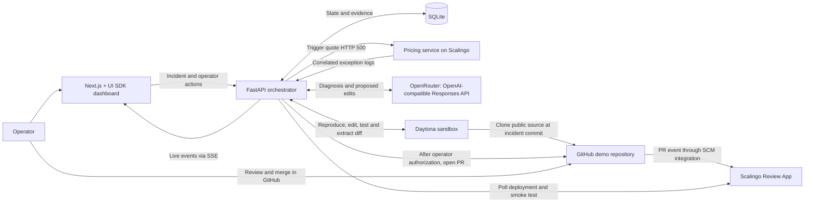

# Architecture

The orchestrator coordinates independent APIs. Daytona executes repository commands in an isolated development environment. Scalingo runs the staging and preview web services. GitHub owns the review and merge workflow.

## Incident evidence

The orchestrator triggers the quantity-zero request with a correlation ID. The pricing service logs the exception with the same ID and returns a generic HTTP 500 body. Local development reads these records from a shared JSON-lines file. In the live workflow the orchestrator obtains the temporary Scalingo logs URL and reads the application log history. Only the correlated evidence belongs to the incident.

The repair runner checks out the base commit, captures failing output, applies proposed file edits and runs the regression and full pricing suite. The bounded repair loop can revise a failed patch up to three attempts total. The dashboard receives persisted state and tool evidence as SSE events. Local staging can use a disposable Docker workspace or a Daytona sandbox that checks out the configured GitHub base SHA. A scripted fixture can supply proposed edits for a credential-free Docker demonstration.

The model client sends requests to OpenRouter using the OpenAI Python SDK. Diagnosis uses a strict JSON schema; repair uses scoped file and test tools. Each repair attempt has a bounded tool conversation. OpenRouter's Responses interface is stateless, so the client resends the conversation and preserves opaque reasoning items alongside tool call IDs. Those items stay out of UI events. Request storage is disabled, required-parameter routing is enabled, and provider failures stop the run without substituting the scripted fixture. [Provider configuration](openrouter-setup.md)

## Publication and human review

A validated patch can be published only after an operator authorizes the incident and GitHub writes are enabled. The branch is scoped to that incident. The Scalingo integration reacts to the PR and deploys a separate preview. The orchestrator waits for deployment and checks the health and quote endpoints before reporting the review as ready. A branch, PR, or successful build alone does not establish HTTP preview validation. A human reviews and merges through GitHub. Production deployment follows the project's separate protected-branch release process.

## Deployment boundary

Use this as an operator-run demo. Keep the orchestrator and dashboard behind network access controls. A single orchestrator process runs the demo jobs and persists their history in SQLite. Keep provider keys at the orchestrator and use a dedicated staging app without production credentials or production data. Treat logs, source, model responses and sandbox output as untrusted input.
